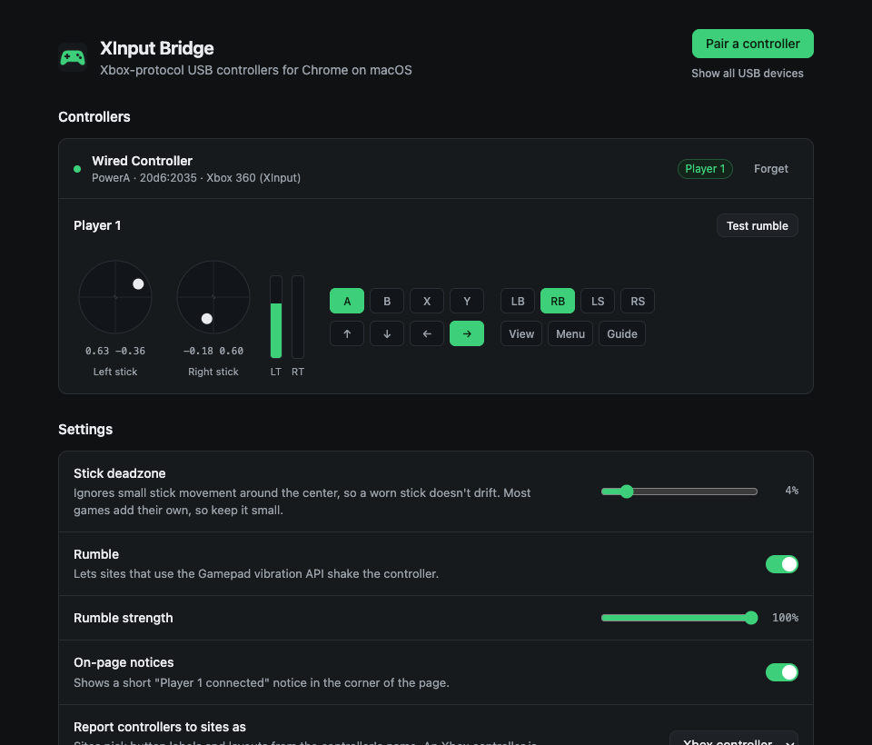
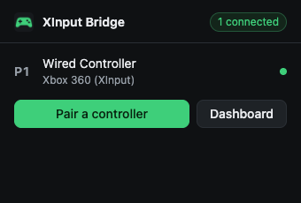

# XInput Bridge

A Chrome extension that makes Xbox-protocol USB controllers work in the browser on macOS:
GeForce NOW, Xbox Cloud Gaming, Amazon Luna, browser games, and any other site that uses the
Gamepad API.



## Why this exists

Most third-party "Xbox" controllers (PowerA, PDP, Hori, Mad Catz, 8BitDo and Logitech pads in
X-input mode, and the many 2.4 GHz dongles that pretend to be an Xbox 360 controller) speak
Microsoft's USB protocol instead of standard HID. Windows has a driver for it. macOS doesn't, and
Chrome only recognizes a short list of genuine Microsoft controllers by their USB ids. Plug one of
the others into a Mac and Chrome's Gamepad API never sees it.

XInput Bridge talks to the controller directly over [WebUSB](https://developer.mozilla.org/docs/Web/API/WebUSB_API)
and hands it to web pages as a regular standard-layout gamepad, analog sticks, triggers and rumble
included.

## Features

- **Pair once, use everywhere.** The USB permission belongs to the extension, not to a site, so a
  paired controller works on every site, inside iframes (itch.io and similar), and in several tabs
  at once.
- **Up to four players**, with the controller's player LED set to match.
- **Rumble** through the standard Gamepad vibration API (`dual-rumble`, plus `trigger-rumble` on
  Xbox One pads).
- **Adjustable radial stick deadzone** for worn sticks.
- **Live input view** to check every button and axis, and **raw USB capture** for debugging.
- **Stays out of the way.** It does nothing on pages that never use the Gamepad API, it can be
  turned off per site, and it makes no network requests.

## Supported controllers

| USB protocol | Typical controllers | Status |
| --- | --- | --- |
| Xbox 360 wired (XInput) | Third-party wired pads and 2.4 GHz dongles that show up as an "Xbox 360 Controller" on Windows | Works. Developed with a PowerA OPS v3 Pro. |
| Xbox 360 Wireless Receiver | Microsoft receiver and clones, up to 4 pads each | Experimental: tested against simulated devices only |
| Xbox One / Series wired (GIP) | PowerA, PDP, Hori and other wired Xbox One / Series pads | Experimental: tested against simulated devices only |

If your controller works or doesn't, please [open an issue](../../issues/new/choose) with what
you found. Reports for the experimental rows are especially useful.

Controllers that already work in Chrome on a Mac (DualShock, DualSense, Switch Pro, Bluetooth Xbox
controllers, plain HID gamepads) don't need this extension.

## Install

XInput Bridge isn't in the Chrome Web Store yet, so you load it as an unpacked extension:

1. Download the latest `xinput-bridge-<version>.zip` from [Releases](../../releases) and unzip
   it, or clone this repository.
2. Open `chrome://extensions` and turn on **Developer mode** (top right).
3. Click **Load unpacked** and choose the folder that contains `manifest.json` (the `extension`
   folder if you cloned the repository). Leave the folder where it is: Chrome loads the extension
   from it.

The dashboard opens after installing. Requires Chrome 118 or newer. Other Chromium browsers with
WebUSB should work but are untested.

> **Upgrading from GFN Controller Bridge?** Remove it first. Only one program can talk to a
> controller at a time, so the two would fight over it.

## Use

1. Plug in the controller (or its USB receiver) and switch it on.
2. Click the XInput Bridge button in the toolbar, then **Pair a controller**. Pick it in Chrome's
   list and click **Connect**. You only do this once per controller.
3. Open your game and **press any button**. Like Chrome's own controller support, pages only see a
   controller after a button press.

Tabs that were open before you installed the extension need a reload; the toolbar button offers
one. The toolbar badge shows how many controllers are connected.




## How it works

```
USB controller ──WebUSB──▶ service worker ──port──▶ relay.js ──DOM event──▶ main-world.js ──▶ navigator.getGamepads()
                           (owns the device)        (isolated world)         (page world)
```

- The **service worker** ([`background.js`](extension/src/background.js)) opens paired controllers
  with WebUSB, decodes their reports ([`protocols.js`](extension/src/protocols.js)), applies the
  deadzone and streams state to every page that uses the Gamepad API. It releases the controllers
  30 seconds after the last such page closes.
- **[`main-world.js`](extension/src/page/main-world.js)** runs in each page. It waits until the page
  calls `navigator.getGamepads()` or listens for gamepad events, then asks the relay to connect.
  Bridged controllers appear in `getGamepads()` at their player index as immutable snapshots, and
  `gamepadconnected` / `gamepaddisconnected` fire as they come and go. Controllers Chrome sees on its
  own keep working alongside them.
- **[`relay.js`](extension/src/page/relay.js)** is the content script in Chrome's isolated world. It
  holds the connection to the service worker and passes messages through.

By default bridged controllers identify themselves to sites as an Xbox 360 or Xbox One controller,
because that is what sites map buttons for. You can switch to the controller's real name in the
dashboard.

## Permissions and privacy

- **"Read and change all your data on all websites"**: needed to add controllers to the Gamepad API
  on whichever site you play. The page scripts only replace `navigator.getGamepads()` and fire
  gamepad events. They don't read page content, and pages that never use the Gamepad API never
  connect to the extension.
- **Storage**: your settings, synced with your Chrome profile.
- **USB**: granted by you, one device at a time, through Chrome's device chooser. No manifest
  permission is involved.

The extension makes no network requests and collects nothing.

## Limitations

- Chrome on macOS is the target. On Windows and Linux the system driver already supports these
  controllers and holds the device, so the extension can't open it and isn't needed.
- Not for the GeForce NOW desktop app, Safari or Firefox: they have no WebUSB.
- Headset audio, the Xbox Series share button and Elite paddles aren't supported.

## Troubleshooting

The dashboard (right-click the toolbar button, then **Options**) has a troubleshooting section and
shows each controller's status. The most common problems:

- **The controller isn't in Chrome's list.** Look for a mode switch and choose X-input / PC mode. Or
  use **Show all USB devices** on the dashboard for controllers that don't advertise the Xbox
  interface.
- **"Another tab, extension or app is using this controller."** Remove other controller extensions,
  close pages that use the controller over WebUSB, then click **Retry**.
- **It works on the dashboard but not in the game.** Reload the game's tab, press a button, and
  check that the site isn't turned off in the toolbar popup.

## Development

```
extension/          the extension itself (load this folder unpacked)
  src/background.js   service worker: USB, players, rumble, clients
  src/protocols.js    packet decoding and controller drivers (pure, unit-tested)
  src/page/           content scripts: main-world.js (page world) and relay.js (isolated world)
  src/ui/             toolbar popup and dashboard
test/unit/          protocol tests (Node's built-in test runner)
test/e2e/           loads the extension in Chromium and drives it with simulated USB controllers
```

```bash
npm install
npm test                          # unit tests
npx playwright install chromium   # once, for the end-to-end tests
npm run test:e2e
```

Set `HEADED=1` to watch the end-to-end tests, or `CHROMIUM_PATH` to use a specific Chromium
build. Branded Google Chrome can't be used for them: since Chrome 137 it ignores `--load-extension`.

### Adding a controller

1. Open the dashboard, expand **Raw USB reports** and click **Start capture**.
2. Press each button and move each stick and trigger, one at a time.
3. If the controller uses one of the existing protocols with a quirk (an init packet, a different
   byte layout), add it to [`protocols.js`](extension/src/protocols.js) next to the existing
   drivers, with a unit test built from your capture. Otherwise open an issue with the capture and
   the device's USB ids.

### Releasing

Bump `version` in `extension/manifest.json` and `package.json`, then push a tag such as `v2.1.0`.
The release workflow checks that the tag matches the manifest, zips the `extension` folder and
attaches it to a GitHub release.

## Credits

Report formats and initialization sequences follow the Linux kernel's
[xpad driver](https://github.com/torvalds/linux/blob/master/drivers/input/joystick/xpad.c).

## License

[MIT](LICENSE)
